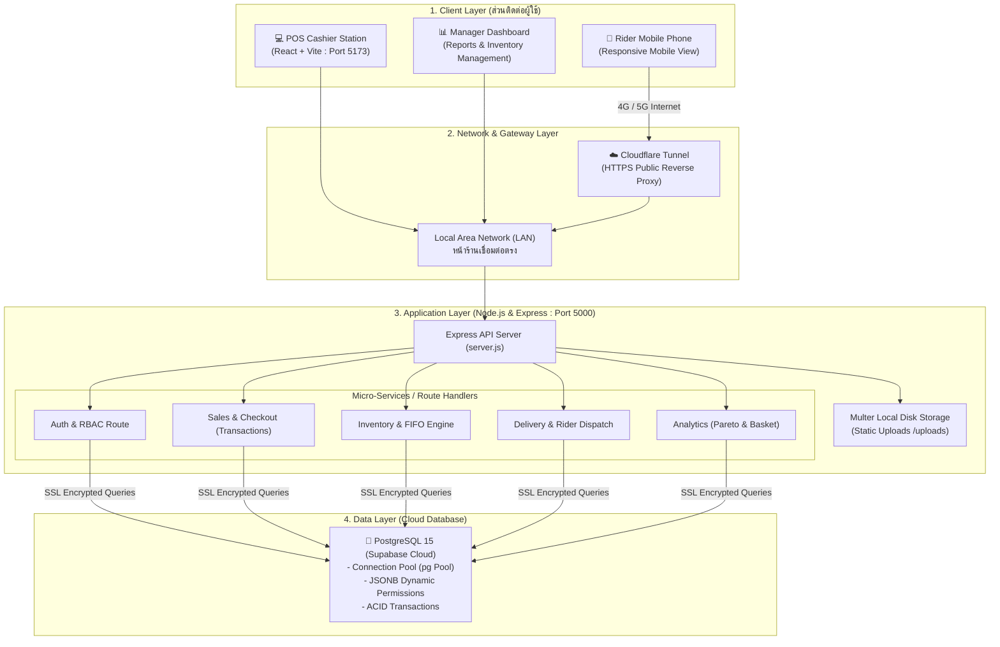
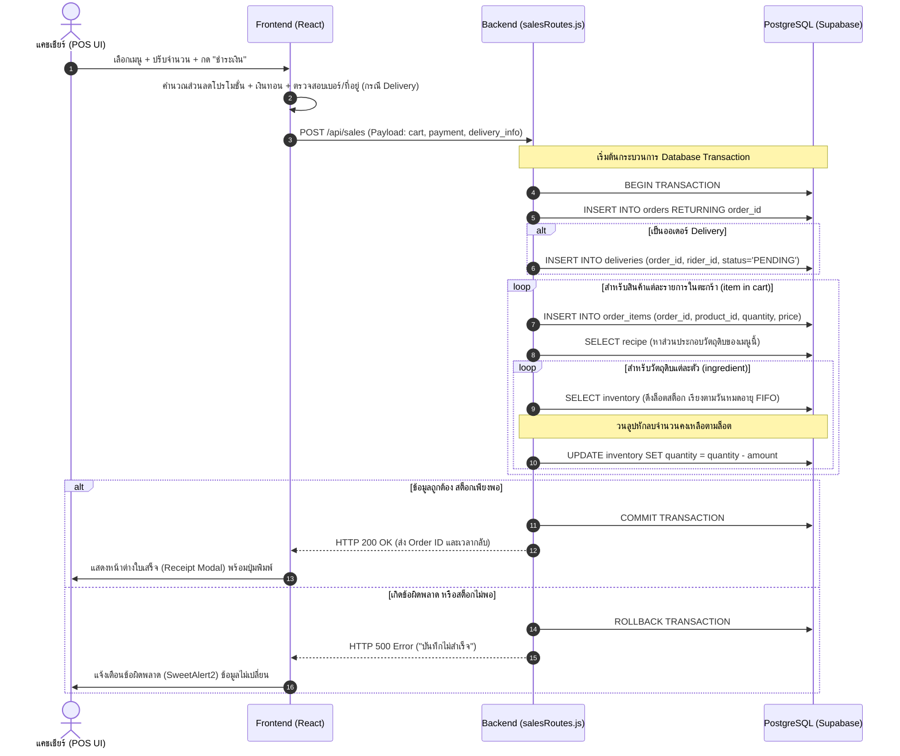
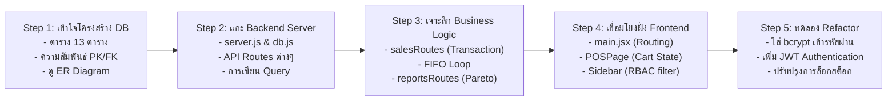

# ☕ คอร์สเรียนสถาปัตยกรรมและการพัฒนาระบบ POS บริหารจัดการร้านคาเฟ่ (PosCafe Masterclass)
> **เอกสารการเรียนรู้ชิ้นที่ 1: แผนการเรียนรู้ สถาปัตยกรรมระบบ การเชื่อมโยงข้อมูล และการวิเคราะห์ข้อจำกัด**  
> *เอกสารชุดนี้จัดทำขึ้นสำหรับการศึกษา ถ่ายทอดความรู้ และเป็นแบบเรียนสำหรับนักพัฒนาและผู้สนใจเรียนรู้ Full-Stack Web Application ในระบบงานขายจริง*

---

## 📑 สารบัญหลักสูตร (Curriculum Overview)
- **Module 1: ปฐมนิเทศและภาพรวมสถาปัตยกรรมระบบ (Full-Stack Blueprint)**
- **Module 2: สถาปัตยกรรม 3 ชั้น (3-Tier Architecture) และ Data Flow การเชื่อมโยง**
- **Module 3: วงจรชีวิตของข้อมูลและตรรกะทางธุรกิจหลัก (Core Business Logic)**
- **Module 4: การรักษาความปลอดภัยและการควบคุมสิทธิ์ (Security & Dynamic RBAC)**
- **Module 5: บทเรียนวิเคราะห์เชิงวิศวกรรม: "ทำไมใช้ได้ และจุดไหนใช้ไม่ได้เพราะอะไร?" (Engineering Trade-offs & Limitations)**
- **Module 6: แนวทางการต่อยอดและการทดสอบระบบ (Next Steps & Testing Roadmap)**

---

# Module 1: ปฐมนิเทศและภาพรวมสถาปัตยกรรมระบบ (Full-Stack Blueprint)

### 1.1 โจทย์ทางธุรกิจของร้านคาเฟ่ (Business Requirements)
ระบบร้านคาเฟ่มีความท้าทายเฉพาะตัวที่แตกต่างจากร้านค้าปลีกทั่วไป 5 มิติ:
1. **ความรวดเร็วในการคิดเงินหน้าร้าน (Speed of Service):** ลูกค้าไม่ต้องการต่อคิวนาน ระบบต้องคำนวณราคา โปรโมชั่น เงินทอน และออกใบเสร็จได้ภายในไม่กี่วินาที
2. **การตัดสต็อกตามสูตรชง (Bill of Materials - BOM):** ลูกค้าไม่ได้ซื้อ "เมล็ดกาแฟ" หรือ "นมสด" โดยตรง แต่ซื้อ "เอสเปรสโซ่เย็น 1 แก้ว" ระบบต้องแปลงเมนูเครื่องดื่มให้เป็นวัตถุดิบและตัดออกจากคลังอย่างถูกต้อง
3. **การหมดอายุของวัตถุดิบ (Perishable Inventory):** นมสด ไซรัป เมล็ดกาแฟ มีอายุการเก็บรักษา ต้องมีระบบควบคุมคลังแบบเข้าก่อน-ออกก่อน (First-In, First-Out: FIFO)
4. **การขายหลายช่องทาง (Omnichannel Sales):** ต้องรองรับทั้งนั่งทานที่ร้าน (Dine-in), ซื้อกลับบ้าน (Takeaway) และเดลิเวอรี่ (Delivery) พร้อมการส่งงานให้ไรเดอร์ผ่านมือถือ
5. **การวิเคราะห์ข้อมูลเพื่อการตัดสินใจ (Data-Driven Decisions):** เจ้าของร้านต้องรู้ว่าคู่สินค้าใดมักถูกซื้อพร้อมกัน (Market Basket Analysis) และสินค้าใดเป็นตัวทำกำไรหลัก 80% ของร้าน (ABC Pareto Analysis)

---

### 1.2 แผนภาพสถาปัตยกรรมภาพรวม (High-Level Architecture)

---

# Module 2: สถาปัตยกรรม 3 ชั้น (3-Tier Architecture) และ Data Flow การเชื่อมโยง

ระบบ PosCafe ออกแบบตามรูปแบบ **Three-Tier Client-Server Architecture** ที่แยกหน้าที่กันอย่างชัดเจน (Separation of Concerns):

### 2.1 ชั้นที่ 1: Presentation Layer (Frontend)
- **เทคโนโลยี:** React 18, Vite, React Router DOM v6, CSS Modules, SweetAlert2, React Icons
- **หน้าที่:** 
  - จัดการ State ในหน้าจอ (UI State) เช่น รายการสินค้าในตะกร้า, หมวดหมู่ที่เลือก, ยอดเงินที่รับมา
  - คำนวณส่วนลดโปรโมชั่นแบบเรียลไทม์ฝั่ง Client เพื่อแสดงผลลัพธ์ให้แคชเชียร์เห็นทันที
  - กรองสิทธิ์การมองเห็นเมนู (View Authorization) ผ่าน Sidebar ตามสิทธิ์ของผู้ใช้ที่เก็บใน `sessionStorage`

### 2.2 ชั้นที่ 2: Application / Business Logic Layer (Backend)
- **เทคโนโลยี:** Node.js, Express.js, Multer, pg (node-postgres), CORS, Dotenv
- **หน้าที่:**
  - เป็นตัวกลางรับ Request และตรวจสอบความถูกต้องของข้อมูล (Validation)
  - ประมวลผลตรรกะทางธุรกิจที่ซับซ้อน เช่น การจับคู่วัตถุดิบตามสูตรชง, การตัดสต็อก FIFO, การคำนวณยอดขายสุทธิ
  - บริหารจัดการความปลอดภัยของฐานข้อมูลผ่าน **Parameterized Queries ($1, $2, ...)** ป้องกัน SQL Injection 100%

### 2.3 ชั้นที่ 3: Data Layer (Database)
- **เทคโนโลยี:** PostgreSQL (โฮสต์บน Supabase Cloud Platform)
- **หน้าที่:**
  - จัดเก็บข้อมูลเชิงสัมพันธ์ (Relational Data) ทั้งหมด 13 ตาราง
  - รักษากฎความสมบูรณ์ของข้อมูล (Referential Integrity) ผ่าน Foreign Key Constraints (`ON DELETE CASCADE` / `RESTRICT`)
  - รองรับการทำงานแบบ **ACID Transactions** เมื่อมีคำสั่งซื้อหลายขั้นตอนเกิดขึ้นพร้อมกัน

---

# Module 3: วงจรชีวิตของข้อมูลและตรรกะทางธุรกิจหลัก (Core Business Logic)

### 3.1 การเดินทางของคำสั่งซื้อ 1 บิล (Checkout Request Lifecycle)

เมื่อแคชเชียร์กดปุ่ม "ยืนยันชำระเงิน" หน้าร้าน ข้อมูลจะไหลผ่านระบบตามขั้นตอนดังนี้:

---

### 3.2 กฎการตัดสต็อกวัตถุดิบแบบ FIFO (First-In, First-Out Algorithm)
ทำไมระบบนี้ถึงไม่ตัดยอดรวมจากตารางเดียว?
- ในธุรกิจร้านอาหารและคาเฟ่ วัตถุดิบแต่ละล็อตซื้อมาคนละวัน มีวันหมดอายุต่างกัน
- หากตัดสต็อกแบบยอดรวมก้อนเดียว พนักงานจะไม่รู้ว่าต้องหยิบนมกล่องไหนมาใช้ก่อน ส่งผลให้นมกล่องเก่าหมดอายุคาตู้เย็น
- **วิธีคิดของโค้ดในระบบนี้:**
  1. ดึงล็อตวัตถุดิบที่ยังไม่หมดอายุและมีจำนวนเหลือมากกว่า 0
  2. เรียงลำดับจาก **วันหมดอายุที่ใกล้ที่สุดขึ้นมาก่อน (`expiration_date ASC`)** ตามด้วยวันที่ซื้อ (`purchase_date ASC`)
  3. หักจำนวนที่ต้องใช้จากล็อตแรก หากล็อตแรกไม่พอ ให้ตัดล็อตแรกจนเหลือ 0 แล้วนำยอดที่เหลือไปหักต่อจากล็อตที่ 2 ทันที

---

### 3.3 วงจรชีวิตของออเดอร์เดลิเวอรี่และการเก็บเงินปลายทาง (Cash On Delivery - COD)

ระบบแก้ปัญหาเรื่อง "เงินสดปลายทาง" อย่างไรไม่ให้ยอดขายในบัญชีผิดพลาด?
1. เมื่อแคชเชียร์คีย์ออเดอร์เดลิเวอรี่ที่เลือก **"เก็บเงินปลายทาง"**:
   - `payment_status` ถูกบันทึกเป็น `'PENDING'` (ยังไม่จ่ายเงิน)
   - `order_status` ถูกบันทึกเป็น `'PENDING_DELIVERY'`
   - `amount_received` ถูกบันทึกเป็น `0`
2. **เงื่อนไขสำคัญในรายงานยอดขาย (Financial Integrity):**
   - ใน `reportsRoutes.js` มีฟังก์ชัน `buildDateCondition` ที่กำหนดเงื่อนไข:  
     `WHERE COALESCE(payment_status, 'PAID') = 'PAID'`
   - ทำให้ยอดเงินของออเดอร์นี้ **จะไม่ถูกนำไปคำนวณเป็นยอดขายของร้าน** จนกว่าไรเดอร์จะส่งของถึงมือลูกค้าและกดยืนยันรับเงิน
3. เมื่อไรเดอร์ส่งของสำเร็จผ่านหน้าจอมือถือ:
   - ไรเดอร์กด "ส่งมอบสำเร็จและเก็บเงินแล้ว"
   - ระบบจะยิง API `PUT /api/deliveries/:id/delivered`
   - สถานะของบิลจะถูกเปลี่ยนเป็น `payment_status = 'PAID'` และ `order_status = 'COMPLETED'` ทำให้ยอดขายถูกดึงเข้ารายงานทันที

---

# Module 4: การรักษาความปลอดภัยและการควบคุมสิทธิ์ (Security & Dynamic RBAC)

### 4.1 การออกแบบ Role-Based Access Control แบบผสม (Hybrid RBAC)
ระบบจัดเก็บสิทธิ์ไว้ 2 ชั้น:
1. **ตาราง `roles`:** มีฟิลด์ `permissions` ชนิด **`JSONB`** ซึ่งเป็น Array ของสิทธิ์ เช่น:  
   `["menu_pos", "menu_delivery", "menu_products", "menu_stocks"]`
2. **ตาราง `employee`:** เก็บ `role_id` ที่ผูกกับตาราง `roles`

**ทำไมต้องใช้ JSONB แทนการสร้างตารางเชื่อม Many-to-Many?**
- **ข้อดี:** สะดวก รวดเร็ว เมื่อผู้ใช้ Login ระบบสามารถดึง Role พร้อมก้อน Permissions ทั้งหมดได้ใน Query เดียว (`JOIN roles ON employee.role_id = roles.role_id`)
- **การตรวจสอบฝั่ง Frontend:** ในคอมโพเนนต์ `Sidebar.jsx` จะนำก้อน `permissions` นี้มากรองเมนูแบบไดนามิก หาก Admin มีการติ๊กเปิด/ปิดสิทธิ์ของตำแหน่งใด เมื่อพนักงานในตำแหน่งนั้นรีเฟรชหน้าจอ เมนูจะแสดงหรือซ่อนทันทีโดยไม่ต้องแก้โค้ด

---

# Module 5: บทเรียนวิเคราะห์เชิงวิศวกรรม: "ทำไมใช้ได้ และจุดไหนใช้ไม่ได้เพราะอะไร?" (Engineering Trade-offs)

นี่คือหัวใจสำคัญที่สุดของการเรียนรู้เชิงลึกทางวิศวกรรมซอฟต์แวร์: **ไม่มีระบบใดที่สมบูรณ์แบบ มีเพียงการแลกเปลี่ยนข้อดี-ข้อเสีย (Trade-offs) ที่เหมาะสมกับบริบทการใช้งาน**

---

### 5.1 ตารางวิเคราะห์จุดแข็ง vs ข้อจำกัดของระบบ PosCafe

| หัวข้อระบบ | ทำไมถึง "ใช้ได้ดี" ในปัจจุบัน (Strengths) | ทำไมถึง "ใช้ไม่ได้ / มีปัญหา" เมื่อระบบโตขึ้น (Limitations) | แนวทางแก้ไขเมื่อต้องการขยายระบบ (Refactoring Roadmap) |
| :--- | :--- | :--- | :--- |
| **1. การตัดสต็อก FIFO (Stock Deduction)** | ทำงานถูกต้องตามหลักบัญชี ตัดวัตถุดิบทีละล็อต หมดอายุก่อนตัดก่อน ไม่ทำให้สต็อกแหว่ง | **เกิด Race Condition เมื่อขายพร้อมกันหลายเครื่อง (High Concurrency):** โค้ดดึงล็อตด้วย `SELECT` ธรรมดา หากแคชเชียร์ 2 เครื่องกดขายพร้อมกันในเสี้ยววินาที อาจแย่งกันตัดสต็อกล็อตเดียวกันจนจำนวนติดลบได้ | ใช้ `SELECT ... FOR UPDATE` เพื่อ Lock แถวใน Database ชั่วคราว หรือใช้ PostgreSQL Stored Procedure ทำการตัดสต็อกภายในก้อนเดียว |
| **2. ความปลอดภัยของรหัสผ่าน (Authentication)** | โค้ดเรียบง่าย เข้าใจง่าย เหมาะกับการเรียนรู้และการสร้างระบบต้นแบบ (Prototype) | **รหัสผ่านถูกเปรียบเทียบแบบ Plain-text หรือเก็บใน DB โดยตรง:** หากฐานข้อมูลรั่วไหล รหัสผ่านของพนักงานทุกคนจะถูกเปิดเผยทันที | นำไลบรารี `bcryptjs` หรือ `argon2` มาทำการ Hash รหัสผ่านด้วย Salt ก่อนบันทึกลงฐานข้อมูลเสมอ |
| **3. การระบุตัวตน (Session Management)** | ใช้ `sessionStorage` เก็บก้อน User Object สะดวกในการอ่านค่าสิทธิ์มาแสดงผลใน React UI | **ไม่ปลอดภัยต่อการถูกสวมสิทธิ์ (Session Tampering):** ผู้ใช้สามารถกด F12 เปิด DevTools แล้วแก้ไข `role_id: 1` หรือเปลี่ยน permissions ใน `sessionStorage` เพื่อให้แถบเมนูแอดมินโผล่ขึ้นมาได้ | ต้องใช้ **JSON Web Token (JWT)** ที่มีการเข้ารหัสด้วย Secret Key ฝั่ง Backend และ Backend API ทุกตัวต้องมี Middleware ตรวจสอบ Token ซ้ำเสมอ |
| **4. สถาปัตยกรรมเครือข่ายสำหรับไรเดอร์** | ใช้ **Cloudflare Tunnel (`cloudflared.exe`)** ช่วยให้ไรเดอร์เปิดหน้าจอบนมือถือ 4G/5G ได้ทันที โดยไม่ต้องเช่า Cloud Server ราคาแพง | ขึ้นอยู่กับเครื่องคอมพิวเตอร์ที่ร้าน (Host Machine) หากคอมพิวเตอร์ที่ร้านดับ หรือปิดโปรแกรม `cloudflared.exe` หน้าจอมือถือไรเดอร์จะใช้งานไม่ได้ทันที | หากธุรกิจมีไรเดอร์จำนวนมาก ควร Deploy ตัว Backend API ขึ้น Cloud Container (เช่น Render, Railway หรือ DigitalOcean) ที่มีสถานะออนไลน์ 24/7 |
| **5. การเก็บไฟล์รูปภาพสินค้า (File Storage)** | ใช้ **Multer** บันทึกไฟล์ลงฮาร์ดดิสก์เครื่อง Server ในโฟลเดอร์ `/uploads` ทำงานเร็ว ไม่มีค่าใช้จ่ายเพิ่ม | หากในอนาคตมีการขยาย Server เป็น 2 เครื่อง (Load Balancing) รูปที่อัปโหลดไว้ในเครื่องที่ 1 จะไม่ปรากฏในเครื่องที่ 2 | ย้ายการอัปโหลดไฟล์ไปไว้บน **Cloud Object Storage** เช่น Supabase Storage Bucket, AWS S3 หรือ Cloudinary |
| **6. สภาพแวดล้อมเครือข่ายออฟไลน์ (Offline-First)** | ทำงานแบบ Client-Server ปกติ ข้อมูลซิงก์ตรงเข้า Cloud PostgreSQL เสมอ ข้อมูลเป็นปัจจุบันที่สุด | **หากอินเทอร์เน็ตที่ร้านหลุด ระบบจะหยุดทำงานทันที (Single Point of Failure):** แคชเชียร์จะไม่สามารถกดคิดเงินหรือดูเมนูสินค้าได้เลย | ติดตั้งระบบ Caching ผ่าน Service Worker (PWA) และเก็บออเดอร์ลง IndexedDB ไว้ชั่วคราว แล้วค่อย Sync เมื่ออินเทอร์เน็ตกลับมา |

---

# Module 6: แผนผังการเรียนรู้สำหรับผู้เรียน (Step-by-Step Learning Track)

หากคุณต้องการศึกษาและทำความเข้าใจโปรเจกต์นี้ให้เชี่ยวชาญ แนะนำให้เรียนรู้ตามลำดับ 5 ขั้นตอนนี้:

---
*เอกสารชิ้นนี้เป็นส่วนหนึ่งของชุดเอกสารการเรียนรู้ระบบ PosCafe — โปรดศึกษาต่อใน **"เอกสารการเรียนรู้ชิ้นที่ 2: คู่มือเจาะลึกการทำงานของโค้ด PosCafe"** เพื่อดูคำอธิบายโค้ดทีละบรรทัด*
